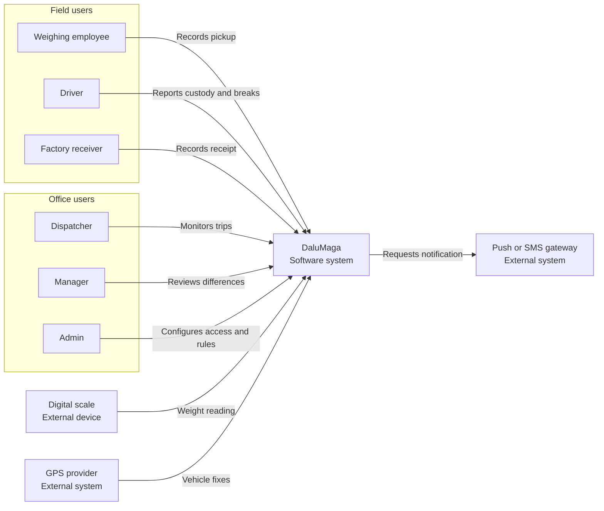
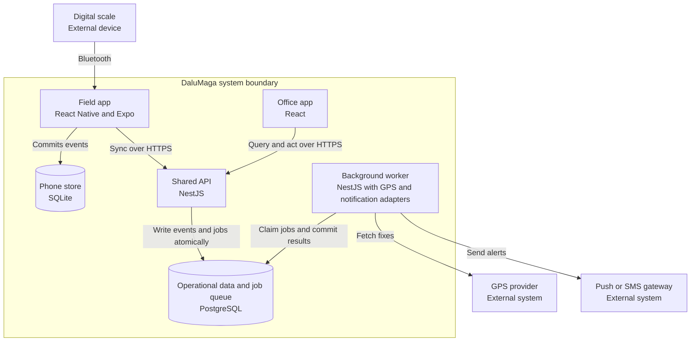
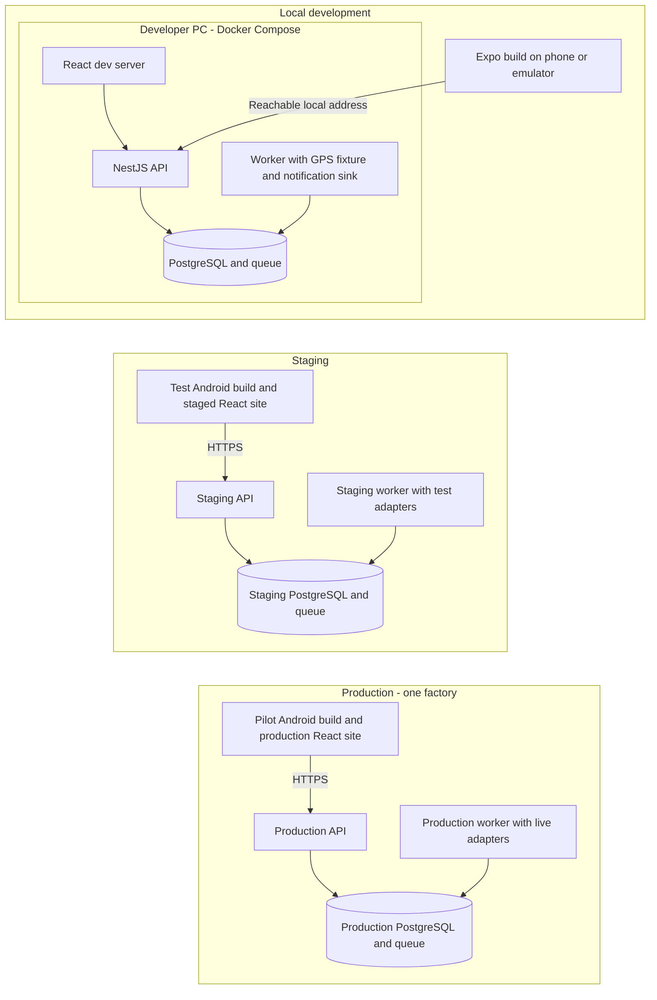
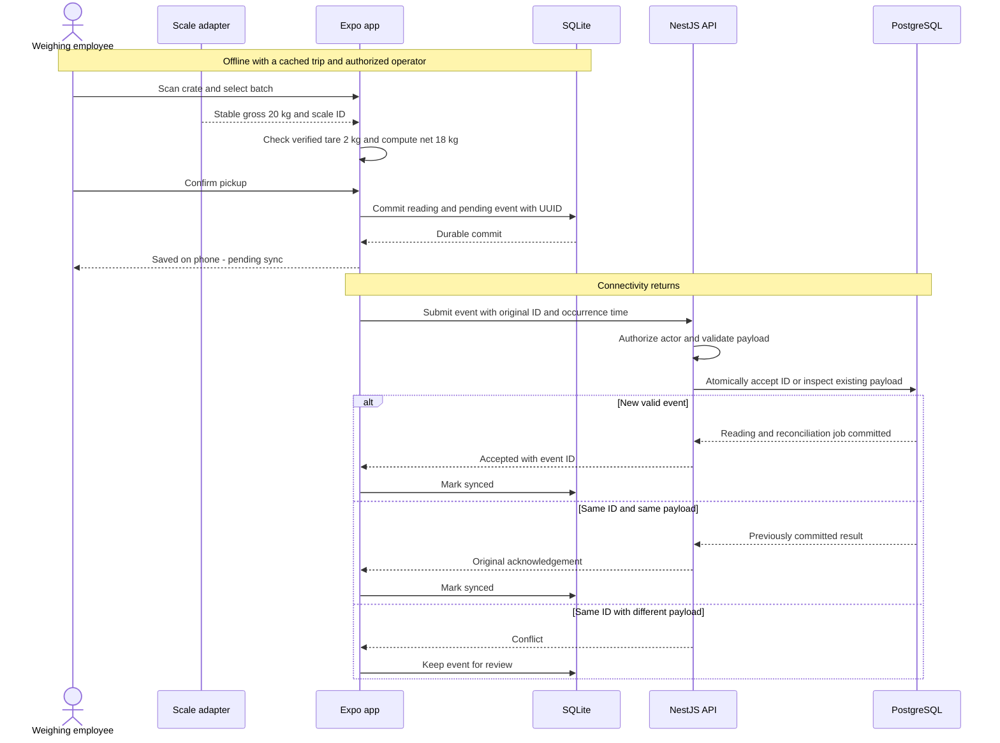
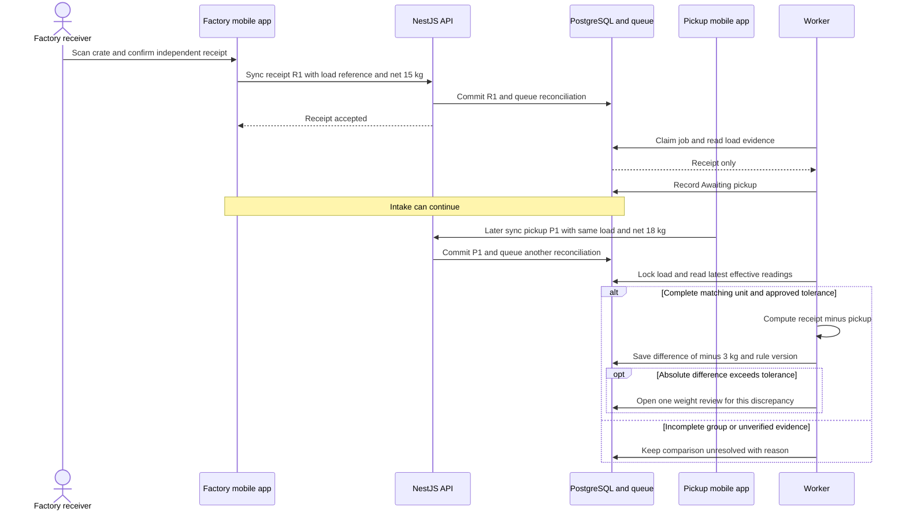
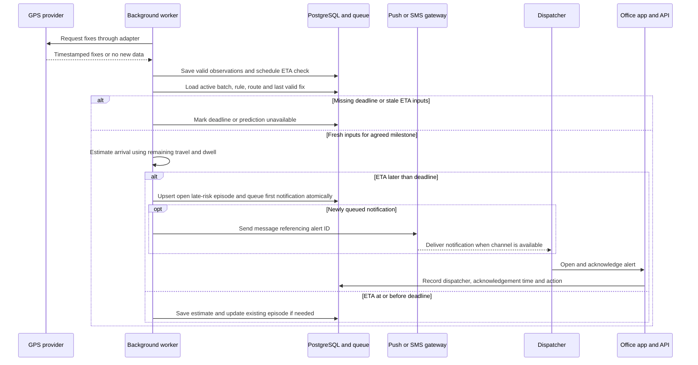
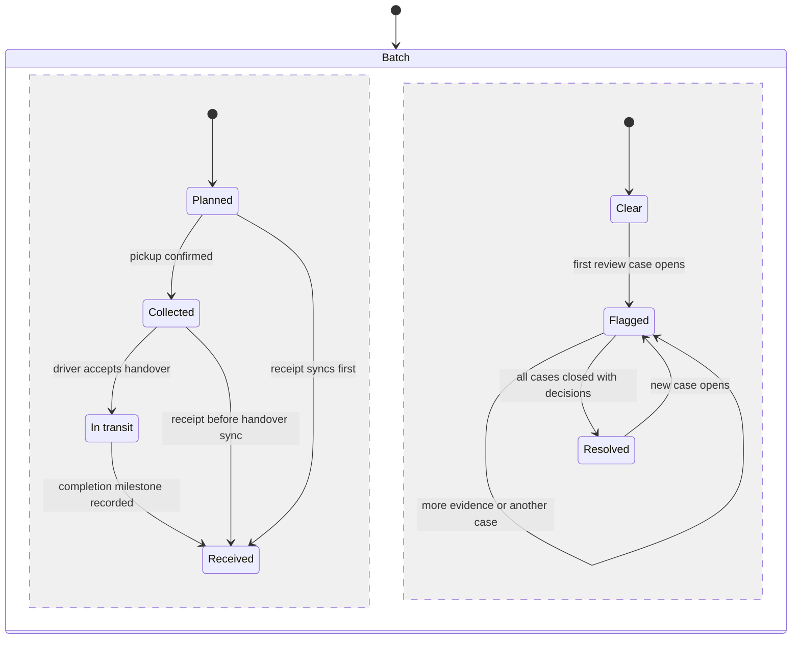

# DaluMaga system architecture

Pilot design for one factory, one route and one vehicle. Hardware adapters support remote development with simulated data.

## 1. C4 system context

- The weighing employee captures pickup weight, the driver acknowledges custody, and the receiver supplies an independent reading. The audit trail records the person acting at each step.
- The scale provides a local reading. The GPS provider supplies timed observations of the assigned vehicle. Neither source decides whether a load is short or a driver stopped.
- The dashboard holds the alert history. Push and SMS draw the on-duty dispatcher’s attention to an alert that already exists there.

## 2. C4 containers

- One NestJS API serves both clients. The worker runs from the same TypeScript codebase in a separate process so a slow provider cannot hold a weighing request open.
- The job queue lives in PostgreSQL. Insert the event and its job in one transaction. Workers claim jobs with expiring leases, retry failed attempts and make effects idempotent. The pilot avoids operating a second datastore, but queue activity shares database capacity.
- The mobile scale adapter validates units and stability before SQLite commits. A simulated adapter exercises the same path. Simulator records stay isolated from real trips.
- ASSUMPTION A1 covers the GPS transport and notification channels. A provider-specific implementation stays behind an adapter. Clients receive scoped API responses and never receive database credentials.

## 3. Deployment

- The mobile build runs on the phone or emulator. Local development can run entirely with a simulated scale, a GPS fixture and a notification sink. Use the physical phone and a compatible development build for Bluetooth verification.
- Promote the same tested backend image to staging and production with separate API and worker entry points. Configure each mobile build and static web site with its own API base URL.
- Each environment has its own database, queue, secrets and recipients. Staging uses test data and test destinations. No record flows from staging into production as part of deployment.
- ASSUMPTION A2 covers hosting. A reachable API and a running worker are required for timely office alerts. A cloud database alone cannot poll GPS or dispatch a notification.

## 4. Offline pickup and later sync

- The SQLite transaction records load, batch, crate, scale, gross, tare, actor and original capture time. Show success after the commit. Missing or unverified tare leaves the net weight unverified.
- A retry uses the same event UUID even after a restart, handover or lost acknowledgement. A PostgreSQL unique constraint and transaction prevent duplicate readings and jobs under concurrent retries.
- The server also records its receipt time. Reconciliation uses original event time and flags suspect device clocks. Transport errors leave the item pending for another attempt.

## 5. Factory receipt arrives before pickup

- ASSUMPTION A3 covers the handover reference. A reusable crate QR alone cannot identify a particular loading. If no reliable match exists, save the receipt for matching and keep it out of shortage calculations.
- A receipt can establish physical delivery before pickup evidence reaches the office. The missing weight stays unknown. For grouped intake, compare only a complete matched group under the approved rule.
- Serialize reconciliation per comparison unit and re-read committed evidence inside the lock. Replayed jobs update the same result. An authorized correction appends a revision and triggers a new evaluation with the previous evidence retained.

## 6. Late-delivery alert

- Evaluate each onboard batch against its own deadline and configured completion milestone. Re-evaluate on a schedule and on changes to route, receipt or timing rules. Any equality is on time for this comparison.
- A committed new episode queues one initial notification. Later predictions refresh that episode. Retry failed channel delivery and reuse a provider idempotency key when supported. The dashboard can show the alert even if a phone notification fails.
- The office shows the age of the last valid fix. Missing GPS supports neither an unexplained stop nor a fresh ETA. Retain prior warnings as history and show their current evidence quality.
- Provider acceptance and human acknowledgement have separate timestamps. When the agreed completion event arrives, record actual timing and retire the active prediction.

## 7. Batch state

- Delivery and review run in parallel. A batch can be both **In transit** and **Flagged** for late risk, or both **Received** and **Flagged** for a weight difference.
- When a full-batch receipt syncs first, the lifecycle can move directly to Received. Earlier pickup and handover events later complete its history without moving the lifecycle backward. A partial receipt keeps the batch open.
- Clear means no open or previously resolved review. Resolved means every open case has a recorded decision. Keep review history after receipt so a later approved correction can reopen a case.

## Assumptions to verify

- **ASSUMPTION A1 · Providers.** The diagrams select a pull-based GPS adapter as the starting design. Confirm access, protocol, device assignments, timestamps and freshness with the GPS provider. Push/SMS capabilities, consent, delivery receipts and retry support depend on the selected gateway.
- **ASSUMPTION A2 · Hosting.** Staging and production are proposed deployment targets. Confirm hosting and costs for a static web site, reachable API, persistent worker and separate PostgreSQL stores before the field pilot.
- **ASSUMPTION A3 · Offline matching.** Both sites can obtain a durable loading reference before the pickup event syncs, such as a pre-issued manifest reference. Confirm the handover workflow and actual weighing granularity with the receiver. Keep unmatched receipts available for authorized review.

Syntax references: [Mermaid C4 diagrams](https://mermaid.js.org/syntax/c4.html) and [GitHub Mermaid rendering](https://docs.github.com/en/get-started/writing-on-github/working-with-advanced-formatting/creating-diagrams#creating-mermaid-diagrams).
