# DaluMaga PostgreSQL schema

Run [001_pilot.sql](../db/001_pilot.sql) once on an empty development database with a dedicated migration owner. The file creates the `dalumaga` schema in one transaction. The reporting snapshots in the pilot success criteria are downstream exports.

## Entity relationships

```mermaid
erDiagram
  APP_USER ||--o{ USER_ROLE : holds
  ROLE ||--o{ USER_ROLE : grants
  FACTORY ||--o{ ROUTE : receives
  ROUTE ||--o{ ROUTE_STOP : orders
  PICKUP_POINT ||--o{ ROUTE_STOP : appears_on
  VEHICLE ||--o{ TRIP : carries
  ROUTE ||--o{ TRIP : follows
  APP_USER ||--o{ TRIP : drives
  TRIP ||--o{ BATCH : transports
  PICKUP_POINT ||--o{ BATCH : supplies
  BATCH ||--o{ CRATE_LOAD : contains
  CRATE ||--o{ CRATE_LOAD : reused_for
  CRATE ||--o{ CRATE_TARE : verified_at
  DEVICE_SCALE ||--o{ CRATE_TARE : measures
  APP_USER ||--o{ CRATE_TARE : verifies
  CRATE_LOAD ||--o| LOAD_RULE : uses
  WEIGHT_RULE ||--o{ LOAD_RULE : governs
  APP_USER ||--o{ WEIGHT_RULE : approves
  APP_USER ||--o{ CLIENT_EVENT : records
  CLIENT_EVENT ||--o| WEIGH_EVENT : identifies
  DEVICE_SCALE ||--o{ WEIGH_EVENT : captures
  CRATE_TARE o|--o{ WEIGH_EVENT : substantiates
  CRATE_LOAD ||--o{ WEIGH_EVENT : weighed_at_stage
  WEIGH_EVENT ||--o{ CORRECTION : revises
  CRATE_TARE ||--o{ CORRECTION : supplies_tare
  CLIENT_EVENT ||--o| CORRECTION : identifies
  CORRECTION ||--o| CORRECTION_DECISION : decided_by
  CLIENT_EVENT ||--o| CORRECTION_DECISION : identifies
  CLIENT_EVENT ||--o| STOP_EVENT : identifies
  STOP_EVENT o|--o| STOP_EVENT : resumes
  TRIP ||--o{ STOP_EVENT : has
  CLIENT_EVENT ||--o| HANDOVER : identifies
  CRATE_LOAD ||--o{ HANDOVER : acknowledged_by
  TRIP ||--o{ GPS_POINT : observed_on
  TRIP ||--o{ ALERT : reviewed_on
  APP_USER o|--o{ AUDIT_LOG : attributed_to
  CLIENT_EVENT ||--o{ JOB : schedules
```



## Weight and comparison

```sql
SELECT load_id, pickup_kg, receipt_kg, difference_kg, tolerance_kg, exceeds_tolerance
FROM dalumaga.load_difference
WHERE load_id = $1;
```

- A crate is permanent while a load identifies one use of that crate, so two deliveries never share a comparison merely because they share a QR code.
- The load must already exist at intake, but its pickup reading may arrive later because each stage independently references the load.
- An immutable tare verification records empty kg, condition, scale, verifier and validity, so a new verification cannot change yesterday’s net weight.
- Verified physical net kg equals gross kg minus the selected verified tare, with at most three fractional digits and no floating-point rounding.
- The view selects the latest approved revision, giving **−3 kg** for 18 kg pickup and 15 kg receipt; missing evidence yields SQL NULL.
- The signed difference preserves direction, while the flag compares its absolute value strictly against the load’s immutable tolerance and stays NULL if the operators coincide or the rule is missing.
- Only comparable intact crate loads belong in this view; grouped or repacked intake needs a separate matched-consignment model before field use.

## Append-only and correction workflow

- Application staff roles live in `app_user`, `role` and `user_role`; database login roles control access to SQL objects separately.
- Run NestJS as a non-owner without schema CREATE, role membership in the migration owner, table write permissions or trigger-management privileges.
- Grant only schema USAGE and EXECUTE on reviewed functions to the API login; keep migration credentials and tables inaccessible to mobile, browser and Supabase public-facing roles.
- Statement-level triggers reject UPDATE, DELETE and TRUNCATE of protected relations, including changes made through ordinary SQL.
- A database superuser or owner can disable triggers, so owner access and backup custody remain operational controls.
- A correction proposes replacement gross and tare against the original weighing and expected revision, and a separate immutable decision records approval or rejection with reviewer, time and reason.
- Each approved revision consumes one unique predecessor, preventing competing approvals from producing two effective weights.
- For correction and decision endpoints, authorize the actor, enforce the configured approval policy and append the typed event, audit entry and reconciliation job in one transaction.
- GPS fix time is separate from receipt time so backfilled positions cannot manufacture a fresh stop.
- An open alert is unique by trip, type and subject; the API validates the subject’s type and trip membership because the subject may be a batch, load or vehicle.
- The durable job row commits with its source event so a crash after acknowledgement cannot lose reconciliation work.

Example grants after provisioning a dedicated `dalumaga_api` database login:

```sql
GRANT USAGE ON SCHEMA dalumaga TO dalumaga_api;
GRANT EXECUTE ON FUNCTION dalumaga.upload_weigh(uuid,uuid,uuid,timestamptz,jsonb)
TO dalumaga_api;
```

## Idempotent upload

Use `SELECT dalumaga.upload_weigh($1,$2,$3,$4,$5::jsonb)` at PostgreSQL READ COMMITTED isolation. Parameters are the persistent client event UUID, authenticated capture actor, device UUID, original occurrence time and canonical validated payload. The JSON fields are `load_id`, `stage`, `scale_id`, `gross_kg`, `tare_id`, `capture_method` and `verified`. NestJS verifies identity, assignment, permission, scale status and the verification evidence before calling the function; never accept a phone’s assertion of authority.

1. A new UUID atomically creates the envelope, reading, audit record and job, and the function returns the UUID after success.
2. An identical retry, including a simultaneous upload, returns the same UUID without duplicating any effect.
3. The same UUID with a different type, actor, device, occurrence time or JSONB payload raises `DM001`; map it to HTTP 409 and keep the local event for review.
4. A distinct UUID for an already captured load/stage hits the unique constraint; roll back the entire call and return a duplicate-capture conflict for review.
5. Other mobile event handlers must reuse the same global event reservation and transaction pattern; only the weighing upload function is implemented in this DDL.

## Assumptions to verify

- **ASSUMPTION A1:** The pilot weighs intact, identified crates and can pre-issue load IDs; confirm intake granularity and handover references before using this design for shortages.
- **ASSUMPTION A2:** One trip uses one route, driver and vehicle, and one batch belongs to one trip; use explicit reassignment records if the field workflow supports transfers.
- **ASSUMPTION A3:** Three fractional kg digits are sufficient and a fixed absolute kg tolerance can be approved per load; confirm scale resolution and rule basis with the factory.
- **ASSUMPTION A4:** A provider supplies or permits a stable GPS source key, and development can isolate simulated records in a separate database.
